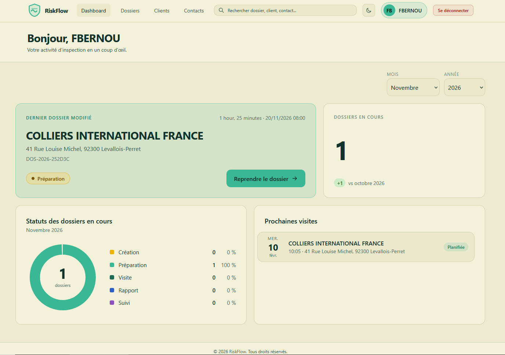
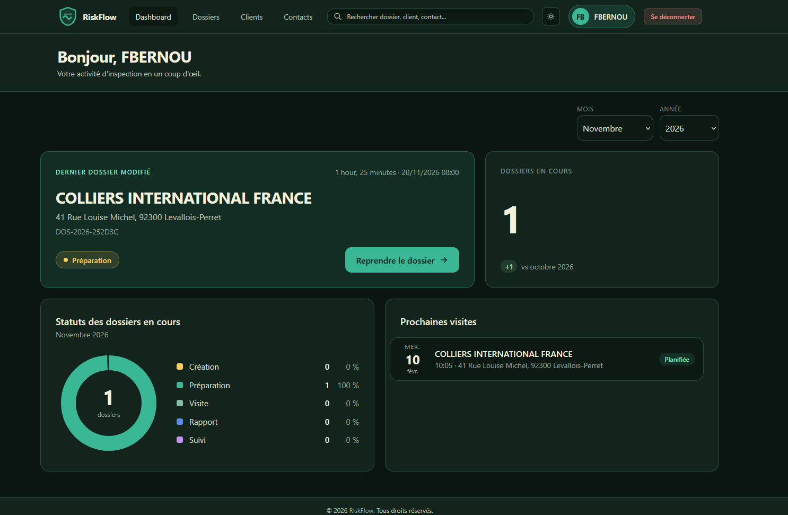
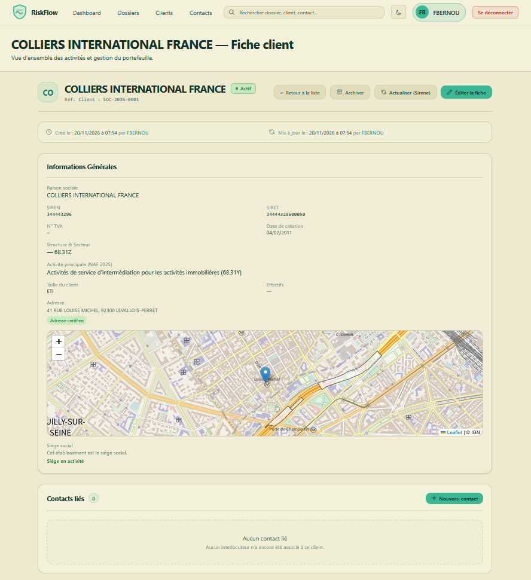
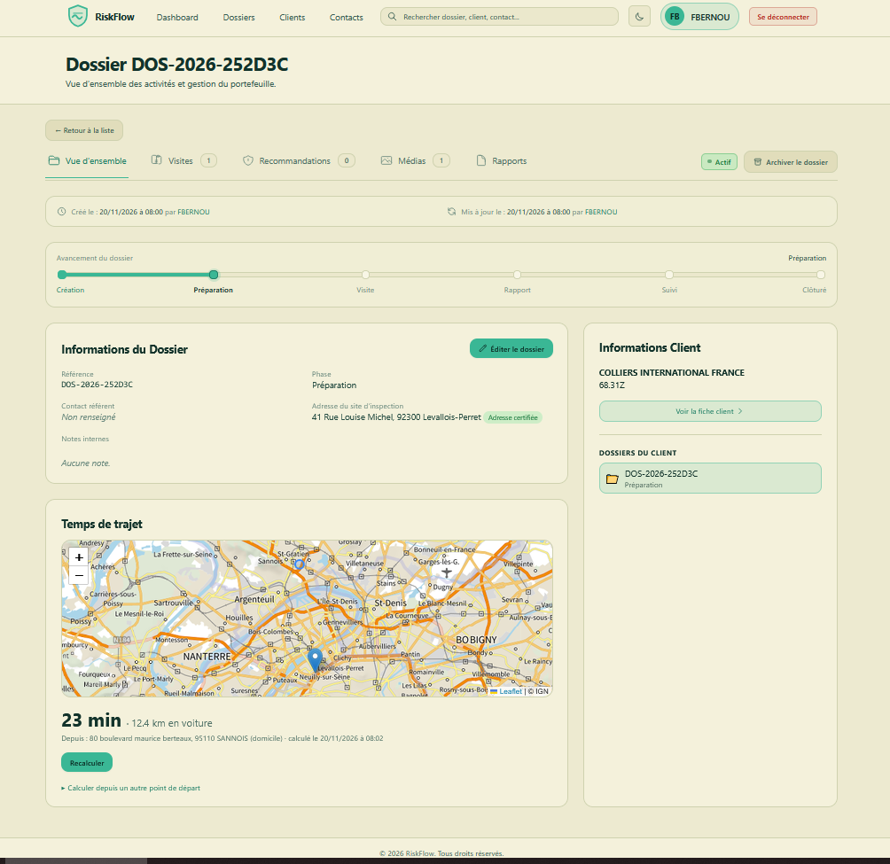
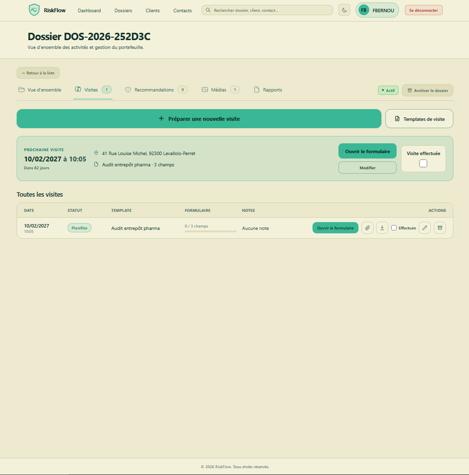
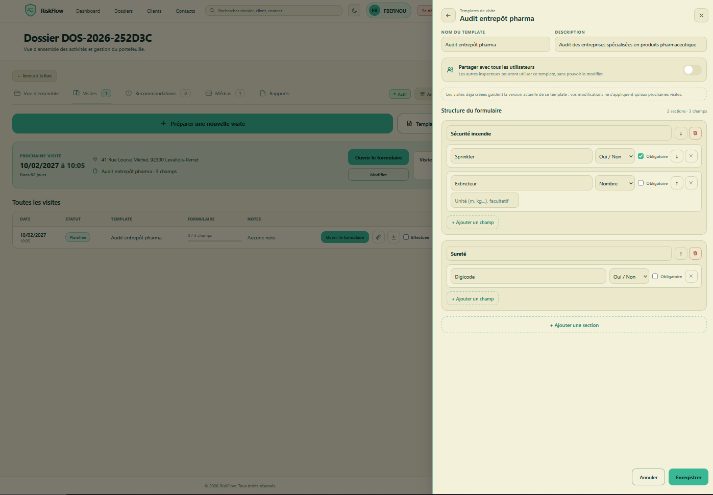
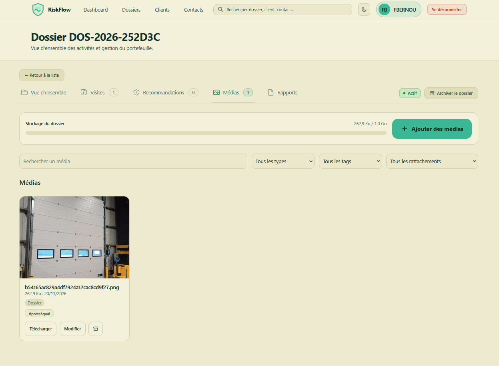

# RISKFLOW

Je souhaitais réaliser une application fullstack pour mon portfolio mais je ne voulais pas que ce soit une coquille vide, une application sans intention, ni objectifs réels. Je voulais qu’elle puisse répondre à un véritable cas d’usage que l’on retrouverait dans une entreprise réelle. Il se trouve qu’un membre de ma famille travaille dans le domaine des assurances en tant qu’inspecteur de risque et que dans son entreprise, ils n’ont pas encore de solution logicielle pour les aider à structurer et rassembler toutes leurs données et flux de travail à un seul endroit. Je me suis donc appuyé sur ses besoins métier pour créer l’application.

> "Des nains sur des épaules de géants"
*Bertrand de Chartres*

## État du projet

Projet personnel en cours de développement, réalisé par sprints : fondations, cœur métier et CRM sont en place ; la gestion des médias est en place ; le rapport de visite est la prochaine étape. L'application est prévue pour un **seul utilisateur, sur un PC Windows** (Docker, voir [Déploiement local](#déploiement-local-avec-docker)) : il n'y a pas d'hébergement en ligne.

## Le métier en bref

L'inspecteur de risques intervient **en amont de la souscription** d'un contrat d'assurance (ce n'est pas de l'expertise sinistre). Il évalue un site industriel ou commercial, identifie les risques (incendie, intrusion, process…) et formule des recommandations de prévention. Une mission suit cinq étapes :

1. **Préparation** : collecte des informations sur le client et le site.
2. **Entretien** avec les interlocuteurs du client.
3. **Visite terrain** guidée par un questionnaire structuré.
4. **Rapport** consolidant les observations.
5. **Suivi des recommandations** émises.

RiskFlow vise à rassembler ce flux de travail, aujourd'hui éclaté entre tableurs, documents et e-mails, dans une seule application pensée pour le terrain (tablette, gros boutons).

## Fonctionnalités

### Disponibles

- **Authentification** : utilisateur personnalisé et profil inspecteur, sessions expirant après 60 minutes d'inactivité.
- **CRM** : clients et contacts, avec pré-remplissage d'un client à partir de son SIRET via l'**API Sirene de l'INSEE** (forme juridique, activité NAF 2025, siège social). Une alerte signale un établissement fermé ou une entreprise cessée, et un bouton « Actualiser (Sirene) » compare la fiche aux données de l'API et applique, champ par champ, ce que l'utilisateur accepte.
- **Adresses certifiées** : autocomplétion et géocodage par la **Géoplateforme IGN** (sans clé), position sur une carte, et temps de trajet en voiture depuis le domicile de l'inspecteur (ou un autre point de départ) jusqu'au site, mémorisé et recalculé seulement à la demande.
- **Dossiers d'inspection** : création, suivi de l'avancement par phase, référence générée automatiquement (`DOS-<année>-<hex>`), filtres, tri et pagination.
- **Visites dynamiques** : les modèles de visite sont décrits en JSON (sections et champs `boolean`, `text`, `select`, `number`), leur structure est validée avec **Pydantic**, et chaque visite d'un dossier travaille sur sa propre copie du modèle. Les réponses sont validées et enregistrées à la volée, champ par champ, y compris après une coupure réseau. Les modèles se créent et se modifient dans un éditeur intégré (panneau latéral), peuvent être partagés avec les autres inspecteurs, et une visite s'exporte en PDF vierge à remplir à la main.
- **Recommandations de prévention** rattachées à un dossier : création depuis l'onglet du dossier (sujet, description, priorité, date limite, notes), puis suivi et modification en ligne.
- **Médias** : photos, PDF, Excel, Word, PowerPoint et vidéos rattachés à un dossier, une visite ou une recommandation, à toutes les étapes de la mission. Images compressées avec Pillow (miniature, EXIF conservé : date, GPS, appareil), tags libres par utilisateur, limites de taille par type, quota approximatif par dossier avec barre de remplissage, fichiers privés servis uniquement à leur propriétaire. Voir [Gestion des médias](#gestion-des-médias-développement-et-production).
- **Archivage (soft delete) et suppression définitive** de tous les objets métier, avec cascades (dossier → visites, recommandations et médias, client → contacts), popups de confirmation et règles de protection (on n'efface qu'un objet préalablement archivé).
- **Traçabilité** : date et auteur de la création, de la dernière modification et de l'archivage.
- **Tests automatisés et CI** : suite de tests Django (factory_boy, API Sirene simulée) et workflow GitHub Actions. Voir [Tests](#tests).
- **Tableau de bord** (les prochaines visites mènent directement à l'onglet Visites du dossier), **recherche globale** et **thème clair / sombre**.

### Prévues

- Rapport de visite : interface en écran partagé, export PDF.
- À plus long terme : notifications, tableau de bord analytique, portail client, base de connaissances avec recherche sémantique (RAG avec `pgvector`), dont une interrogation des documents d'un dossier (Gemini).

## Captures d'écran

| | |
|---|---|
| **Tableau de bord** (thème clair)<br> | **Tableau de bord** (thème sombre)<br> |
| **Clients** (CRM, données Sirene)<br> | **Dossier d'inspection**<br> |
| **Visites**<br> | **Éditeur de modèle de visite**<br> |
| **Médias**<br> | |

## Stack technique

| Couche | Technologies |
| --- | --- |
| Back-end | Python 3.12, Django 6 |
| Base de données | PostgreSQL (via `psycopg` 3), `JSONField` pour les formulaires dynamiques |
| Front-end | Templates Django, HTMX (`django-htmx`), Tailwind CSS v4 (`django-tailwind`, binaire standalone, sans npm) |
| Validation | Pydantic 2 |
| Fichiers | Système de fichiers local (`MEDIA_ROOT`), Pillow pour les images, WeasyPrint pour les PDF |
| Intégrations | API Sirene (INSEE), référentiel de nomenclatures `id.insee.fr` (libellés NAF 2025), Géoplateforme IGN (géocodage, itinéraires, fond de carte), sans clé |
| Déploiement | Docker Compose (Django + gunicorn + WhiteNoise, PostgreSQL), un seul PC, accès local uniquement |
| Outillage | `uv` |

Le choix d'HTMX permet de limiter le JavaScript au strict minimum : les listes, formulaires en modale, onglets et confirmations sont des fragments HTML renvoyés par le serveur.

## Architecture

```
apps/
  accounts/    Utilisateur personnalisé et profil inspecteur
  core/        Code commun : modèle de traçabilité, layout, dashboard, recherche, thème
  crm/         Clients, contacts, client de l'API Sirene (siège, état administratif, NAF 2025)
  inspections/ Dossiers, modèles et instances de visite, recommandations
  medias/      Fichiers joints (images, documents, vidéos), tags, quota, stockage
  theme/       Configuration Tailwind et tokens de thème
config/        Settings et routage du projet
```

Quelques principes :

- **Couche services** : la logique métier et les requêtes vivent dans `<app>/services/`, pas dans les vues. Les vues restent fines (authentification, méthode HTTP, appel du service, rendu), ce qui prépare l'exposition future d'une API.
- **`TrackingModel`** : modèle abstrait commun à la plupart des entités métier, qui gère horodatage, auteurs et archivage, avec des hooks de cascade surchargeables.
- **Archiver avant de supprimer** : la suppression définitive n'est possible que sur un objet déjà archivé.

## Installation locale

### Prérequis

- Python 3.12 et [uv](https://docs.astral.sh/uv/)
- PostgreSQL
- Pango, nécessaire à WeasyPrint pour l'export PDF (déjà installé dans l'image Docker ; sous Debian, Ubuntu ou WSL : `sudo apt install libpango-1.0-0 libpangoft2-1.0-0`)
- Une clé d'API Sirene, à obtenir sur le [portail des API de l'INSEE](https://portail-api.insee.fr/) (facultative, seulement pour le pré-remplissage par SIRET)

### Mise en route

```bash
git clone https://github.com/nathanolszowski/RiskFlow.git
cd RiskFlow
uv sync
```

Créer un fichier `.env` à la racine (il est ignoré par Git) :

```env
DB_NAME=riskflow
DB_USER=<utilisateur>
DB_PASSWORD=<mot_de_passe>
DB_HOST=localhost
DB_PORT=5432
INSEE_API_KEY=<votre_cle>
SECRET_KEY=<generer_votre_cle_secrete_django>
```

Puis appliquer les migrations, créer un administrateur et lancer le serveur :

```bash
uv run python manage.py migrate
uv run python manage.py createsuperuser
uv run python manage.py tailwind dev
```

`tailwind dev` lance à la fois le serveur Django et le watcher Tailwind. L'application est alors accessible sur <http://127.0.0.1:8000/auth/login/>. Les modèles de visite se créent depuis l'onglet Visites d'un dossier, bouton « Templates de visite » (éditeur en panneau latéral).

### Gestion des médias

Les fichiers ne sont **jamais** servis par une URL publique : les vues `medias:media_file` et `medias:media_thumbnail` vérifient que l'utilisateur est le propriétaire du dossier avant d'envoyer le fichier. Django les streame lui-même, avec les requêtes `Range` (nécessaires pour lire les vidéos sur Safari).

| | Développement | Déploiement local (Docker) |
| --- | --- | --- |
| Settings | `config.settings.dev` (défaut de `manage.py`) | `config.settings.local` |
| Stockage | Dossier `media/` à la racine (`MEDIA_ROOT`, ignoré par Git) | Volume `media` monté sur `/data/media` |
| Configuration | Aucune | Aucune |

Les fichiers sont écrits dans `folders/<id du dossier>/` sous un nom aléatoire. Supprimer un média (ou son dossier) supprime aussi le fichier. En développement, pour repartir de zéro, supprimer le dossier `media/` en même temps que la base.

**Limites** (variables optionnelles, en Mo) :

| Variable | Défaut | Portée |
| --- | --- | --- |
| `MEDIA_MAX_IMAGE_MB` | 25 | Image reçue (avant compression) |
| `MEDIA_MAX_PDF_MB` | 25 | PDF |
| `MEDIA_MAX_OFFICE_MB` | 25 | Excel, Word, PowerPoint |
| `MEDIA_MAX_VIDEO_MB` | 250 | Vidéo (mp4, mov, webm), stockée telle quelle |
| `MEDIA_FOLDER_QUOTA_MB` | 1024 | Quota approximatif par dossier, médias archivés compris |

Un fichier refusé (format, taille, quota) ouvre un pop-up explicatif ; les images de plus de 50 mégapixels sont refusées. Les formats HEIC ne sont pas acceptés.

### Commandes utiles

```bash
uv run python manage.py runserver        # serveur seul
uv run python manage.py tailwind build   # compiler le CSS
uv run python manage.py test --settings=config.settings.test   # lancer les tests
```

### Tests

Les tests utilisent PostgreSQL (verrous `select_for_update`, contraintes `CHECK`) : le rôle de la base doit pouvoir créer une base de test.

```bash
sudo -u postgres psql -c "ALTER ROLE <utilisateur> CREATEDB;"   # une seule fois
uv run python manage.py test --settings=config.settings.test    # toute la suite
uv run python manage.py test inspections --settings=config.settings.test -v 2   # une app, avec la description de chaque test
uv run coverage run manage.py test --settings=config.settings.test && uv run coverage report
```

- Un paquet `tests/` par app, avec ses fabriques (`factories.py`) ; aucun appel réseau (API Sirene et service NAF simulés avec les fichiers de `apps/crm/tests/fixtures/`) ; fichiers écrits dans un dossier temporaire.
- Chaque module, classe et méthode de test a une docstring en anglais ; `uv run ruff check --select D1 apps/*/tests` le vérifie.
- La CI (`.github/workflows/ci.yml`) lance, sur chaque push et pull request vers `develop` et `main` : lint, format, docstrings des tests, contrôle des migrations, tests et couverture (seuil de 70 %).
- Le cloisonnement par utilisateur (dossiers, visites, recommandations, médias, templates privés, recherche globale des dossiers) est verrouillé par les tests d'isolation (`test_isolation.py`). Les clients et leurs contacts sont partagés entre utilisateurs, ce que vérifie `CrmSharingTests`.
- Ce que les tests ne couvrent pas (navigateur, réseau, tablette) se vérifie avec la [recette manuelle](#recette-manuelle).

## Déploiement local avec Docker

RiskFlow tourne sur un PC (Windows avec Docker Desktop et WSL2) et n'est joignable que depuis ce PC, sur <http://localhost:8000>. Deux conteneurs : `web` (gunicorn, WhiteNoise) et `db` (PostgreSQL 16). Le port n'est publié que sur `127.0.0.1`.

1. Copier `.env.example` en `.env` et renseigner `SECRET_KEY`, `DB_NAME`, `DB_USER`, `DB_PASSWORD` (et `INSEE_API_KEY`). `DB_HOST` est fixé par `compose.yaml`.
2. Construire et démarrer, puis appliquer les migrations et créer le compte :

```bash
docker compose build
docker compose up -d db
docker compose run --rm web python manage.py migrate
docker compose run --rm web python manage.py createsuperuser
docker compose up -d
```

Les données vivent dans les volumes Docker `pgdata`, `media` et `logs` : un volume n'est **pas** une sauvegarde. Procédure complète (mise à jour, sauvegarde, restauration, dépannage) : `docs/riskflow-deploiement.md`, et scripts dans `scripts/`. Pour chaque nouvelle version (préparation, tag Git, déploiement, vérifications, cookbook des commandes) : [checklist de release](docs/riskflow-checklist-release.md).

Le contrôle des réglages se lance avec `docker compose run --rm web python manage.py check --deploy`. Les avertissements liés à HTTPS (`security.W004`, `W008`, `W012`, `W016`) sont attendus : l'application n'est servie qu'en HTTP sur `localhost`.
